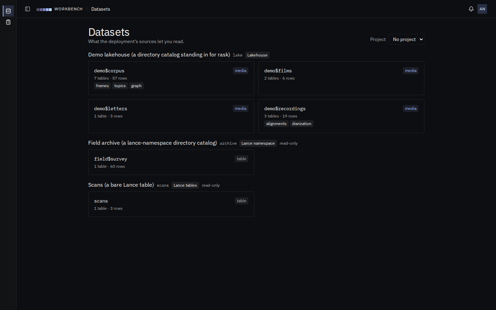
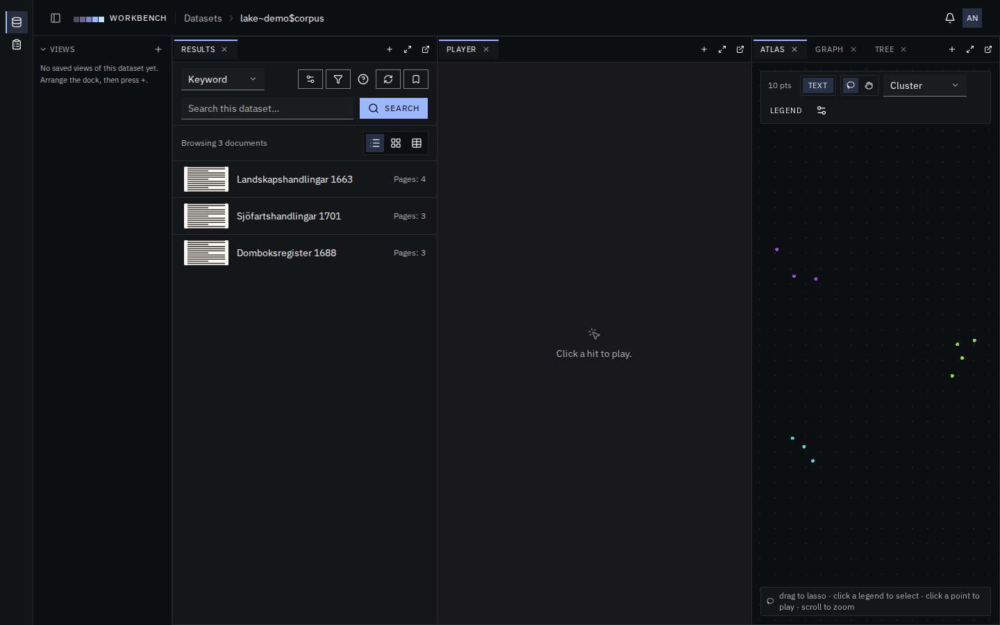
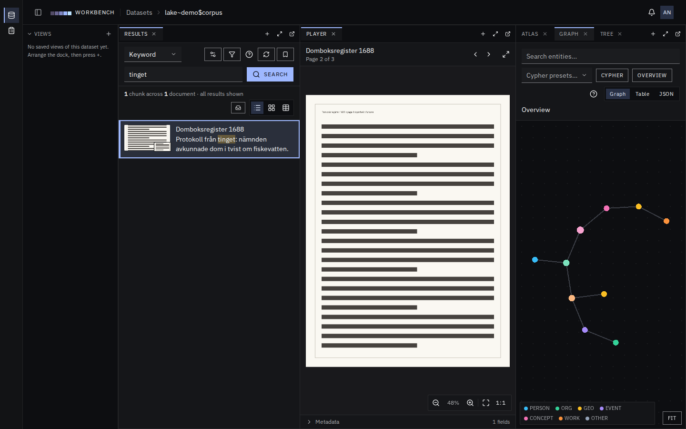
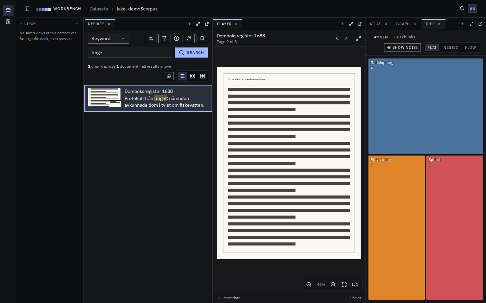
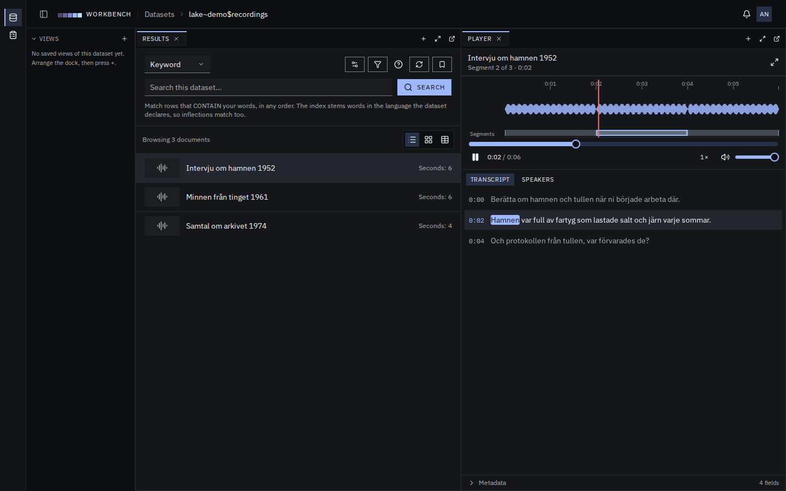
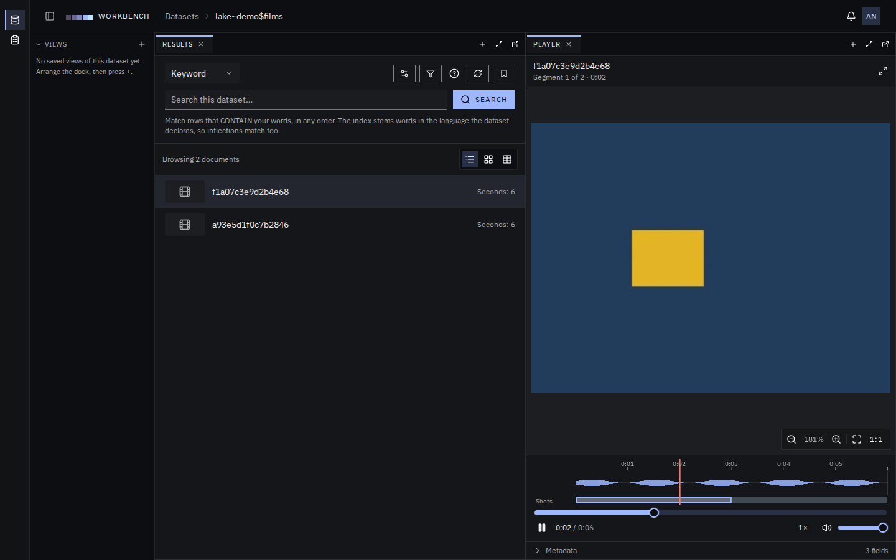
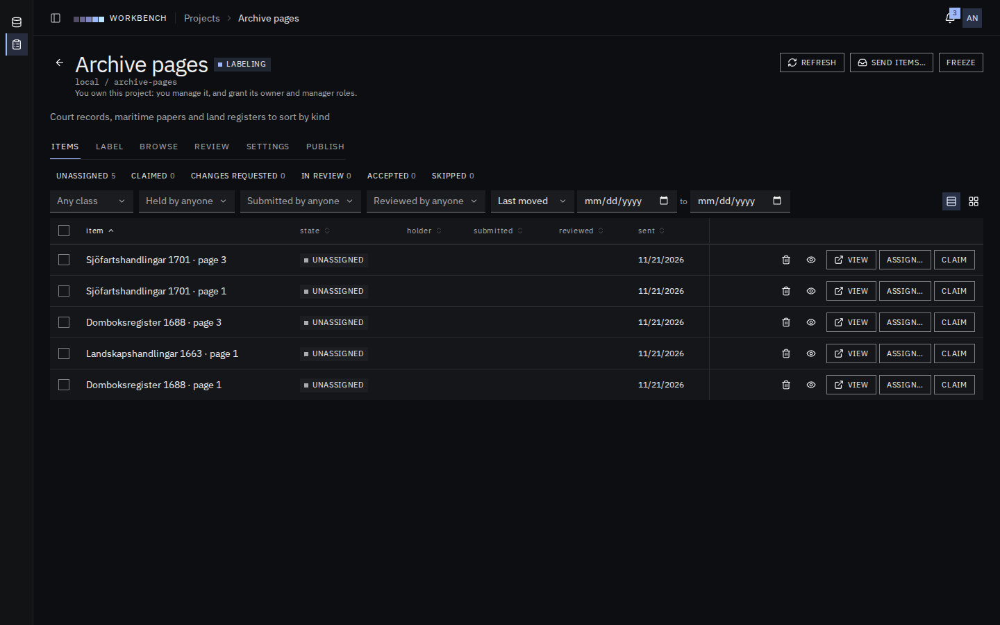
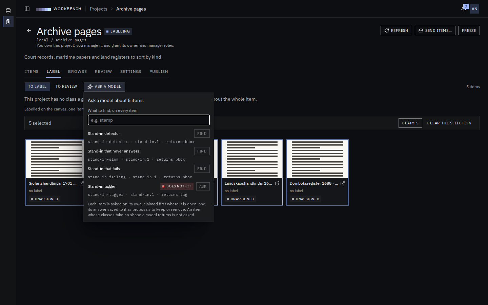
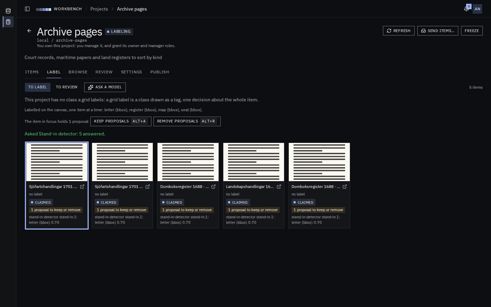
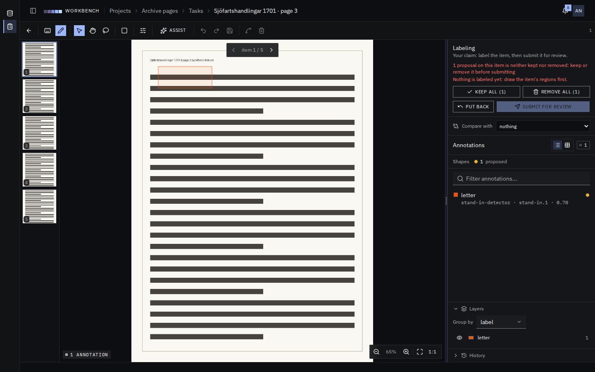

# workbench

Explore, search and annotate datasets, and label them together with models, as one browser app. The workbench reads any
Lance source a deployment declares: a [rask](https://github.com/AI-Riksarkivet/rask) lakehouse through its published
doors and the credentials its catalog vends, any lance-namespace implementation, or a bare Lance table. It runs with or
without rask, and is never part of it.

- **explorer**: the viewer, search, and a dataset's views in the app
- **annotator**: projects, tasks, the labeling canvas, review and publish, with assist asking a model endpoint the deployment names (`docs/model-protocol.md`)
- **flows**: model pipelines; parked, with no screen and no deployment (`docs/adr/0011`)

## What it looks like

Shot with `playwright-cli` on `make local` (the demo sources, sign-in off), at `8a5739c`.

**The sources a deployment declares.** Every dataset of a lakehouse, a lance-namespace catalog or a bare Lance table, with
its tables and rows.

**A dataset is one dock.** Results, the player and the dataset's views are panels arranged side by side. The atlas plots
the embeddings, drawn with WebGPU.

**Search, the page it found, and the knowledge graph.** A keyword search lists the chunk it matched; the player opens
its page; the Graph panel draws the dataset's entities.

**The topic tree** of the same corpus, as a treemap; a topic chosen here filters the search.

**Audio and video.** A recording plays with its waveform, its segments and a transcript that follows playback; a film
plays its frames over the same time strip.

**A project.** Items sent from a search land in a project, listed by state, holder and reviewer.

**A model over many items.** In the Label grid, select items and ask a model: each model is judged against the items'
classes, and one that takes words is asked once for the whole selection.

Each item gets the model's proposals, with the model, its version and its score, to keep or remove in bulk.

**The labeling canvas.** A proposal is drawn on the page and must be kept or removed before the item is submitted.

## Working on it

The work is tracked as GitHub issues, in the order of the pinned "Workbench map" issue; the decisions are in
`docs/adr/`. Development: `make install`, then `make local` to run it on demo data, `make check` and `make test`. Images
are built with Dagger: `dagger call image --name=<stem>`.

Licensed under the Apache License 2.0 (`LICENSE`). Third-party code keeps its own licence and notice.
